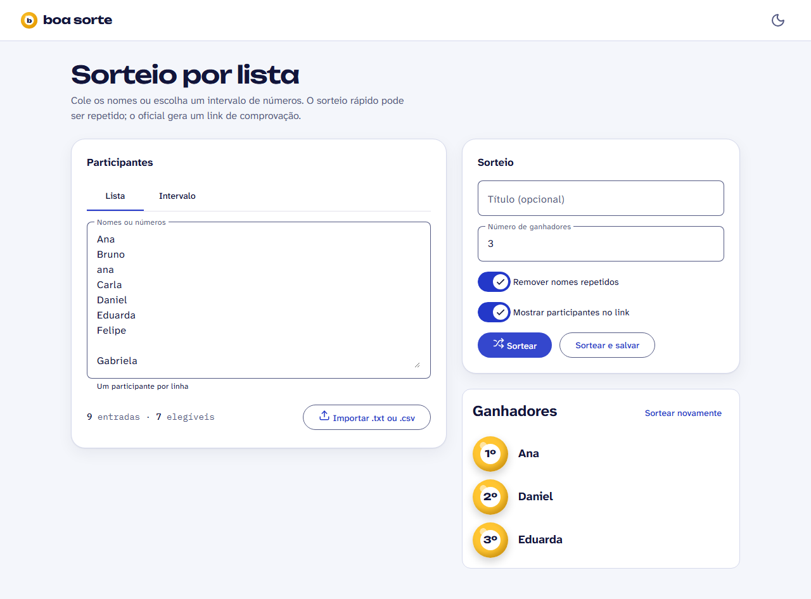
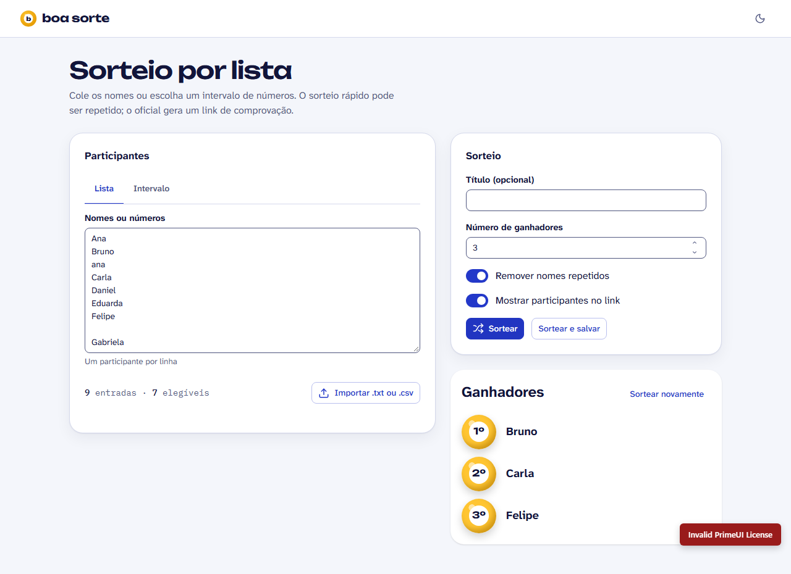
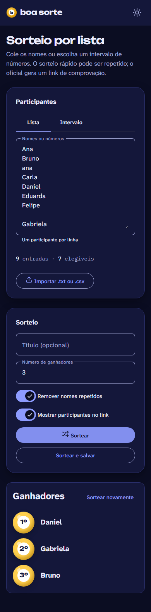
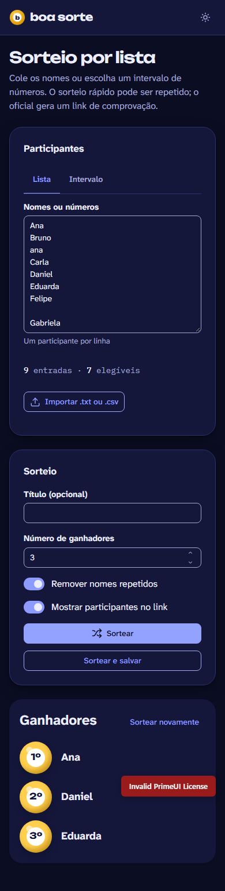

# ADR 0001 — Biblioteca de componentes do client

**Status:** aceita · **Data:** 2026-10-12 (decidida pelo usuário após a PoC) · **Spec:** [004 — Design system](../004-design-system/spec.md)
**Evidências:** branch `poc/component-library`, pasta `poc/` (apps, `evaluation/evaluate.spec.ts`, `results/`, `screenshots/`)

## Contexto

O client precisa de uma biblioteca de componentes que respeite os nossos tokens (temas claro/escuro), seja acessível, funcione com Angular 22 zoneless e deixe o BoaSorte com identidade própria. As duas candidatas definidas no Clarify foram **Angular Material 22.2** e **PrimeNG 22.1**.

## Método

A mesma tela (sorteio por lista: abas, textarea, números, importar arquivo, toggles, botões, diálogo de confirmação, toast/snackbar, card de resultado) foi construída nas duas bibliotecas. O que **não** muda entre elas é compartilhado (`poc/shared/`): tokens, fontes, layout, estado da tela, lógica de sorteio, troca de tema e o elemento-assinatura (bolas de loteria).

Medições automatizadas com Playwright sobre o **build de produção**:
- axe-core (WCAG 2.0/2.1 A + AA) nos dois temas: tela principal, aba Intervalo e diálogo aberto.
- Navegação só com teclado: chegar a "Sortear", abrir o diálogo, verificar onde está o foco e para onde ele volta ao fechar com Esc.
- Prints: desktop e mobile × claro e escuro + diálogo.

## Resultados

### Medições

| | Angular Material 22.2 | PrimeNG 22.1 |
|---|---|---|
| Bundle initial (gzip) | **125,4 kB** | 141,7 kB (+13%) |
| axe (sérias/críticas) | **0** nos dois temas | **1 crítica** nos dois temas: botão "×" do diálogo sem nome acessível |
| Foco ao abrir o diálogo | dentro do diálogo ✅ | dentro do diálogo ✅ |
| Foco ao fechar com Esc | **volta ao botão de origem** ✅ | vai para o `<body>` ❌ |
| Papéis ARIA do diálogo | `dialog` | `alertdialog` **duplicado** (host + div interna) |
| Zoneless (sem `zone.js`) | ✅ | ✅ |
| Linhas para aplicar os nossos tokens | 62 (`mat.theme-overrides` sobre os system tokens) | 129 (preset + escala primária 50–950 + estilos) |
| Licença | **MIT** | **PrimeUI License (comercial)**: chave obrigatória; sem ela, um selo "Invalid PrimeUI License" aparece na tela |

### Observações qualitativas
- **Tematização:** no Material, apontar os *system tokens* M3 para as nossas variáveis foi direto; a fonte de display chegou sozinha aos títulos de diálogo via `brand-family`. No PrimeNG, mapear só a cor primária não bastou: a escala esmeralda do Aura vazou nas bordas dos botões contornados até gerarmos a escala 50–950 a partir do token.
- **Liberdade visual:** o PrimeNG é mais neutro (rótulos acima dos campos e campos simples), mais próximo de uma identidade própria. O `mat-form-field` tem um visual Material forte (rótulo flutuante dentro do contorno), que dá para ajustar mas exige trabalho contra o padrão.
- **Cobertura:** o PrimeNG traz mais componentes prontos (upload de arquivo, input numérico com botões, toast com severidade, mensagens). No Material, eles se resolvem com o CDK + componentes simples nossos.
- **Licença do PrimeNG:** a Community License é gratuita apenas para organizações com menos de US$ 1 mi de receita anual, menos de 5 devs, menos de 10 funcionários e menos de US$ 3 mi de investimento; exige **renovação anual** e uma chave no build. Acima disso, a licença é paga por desenvolvedor. Os termos proíbem remover o mecanismo de licença. No mobile, o selo cobre conteúdo da tela.

| Material — claro, desktop | PrimeNG — claro, desktop |
|---|---|
|  |  |

| Material — escuro, mobile | PrimeNG — escuro, mobile |
|---|---|
|  |  |

## Notas (critérios da spec 004)

| Critério | Peso | Material | PrimeNG |
|---|---|---|---|
| Temas dirigidos pelos nossos tokens | 3 | 4 | 3 |
| Liberdade visual | 3 | 3 | 4 |
| Acessibilidade | 3 | 5 | 2 |
| Tamanho do bundle | 2 | 4 | 3 |
| Cobertura de componentes | 2 | 3 | 5 |
| Zoneless/signals e Angular 22 | 2 | 5 | 4 |
| DX e documentação | 1 | 4 | 4 |
| Manutenção e licença | 1 | 5 | 1 |
| **Total ponderado** (máx. 85) | | **69** | **56** |

Os problemas de acessibilidade do PrimeNG têm contorno (configurar `translation.aria.close`, devolver o foco manualmente), mas são trabalho extra em toda tela com diálogo. A licença, por outro lado, não é uma questão de nota: é um **risco de negócio recorrente** (chave no CI/Docker, renovação anual, custo se a empresa crescer).

## Decisão

**Adotar Angular Material 22 + CDK**, com estas regras para não parecer um "app Material genérico":
1. Tema só via `mat.theme` + `mat.theme-overrides` apontando para os nossos tokens (`src/styles/`); nenhuma cor literal em componente.
2. Usar Material onde ele agrega comportamento acessível: diálogo, snackbar, abas, slide-toggle, menu, tooltip, progresso.
3. Campos de formulário: avaliar na fundação (D011) um wrapper próprio `app-field` (rótulo acima, ajuda e erro) sobre `matInput`, para fugir do rótulo flutuante e manter o visual da PoC do PrimeNG, que ficou mais próximo da identidade.
4. Componentes que o Material não tem (upload de arquivo, bolas de resultado) são nossos, construídos com o CDK quando houver interação complexa.
5. Ícones: **Lucide** (`@lucide/angular`, ISC), já usado nas duas PoCs.

## Consequências
- ➕ Zero violações de acessibilidade no ponto de partida; foco gerenciado pela biblioteca.
- ➕ Licença MIT, mantida pelo time do Angular e lançada junto com cada major.
- ➕ Bundle menor.
- ➖ Mais componentes próprios (upload, wrapper de campo) do que com o PrimeNG.
- ➖ O visual padrão do Material puxa para o "jeito Google"; a disciplina do item 1 e o wrapper do item 3 são obrigatórios.
- O código da PoC permanece só na branch `poc/component-library`, que não é mergeada. Este ADR e as imagens em `0001/` vão para a linha principal.
